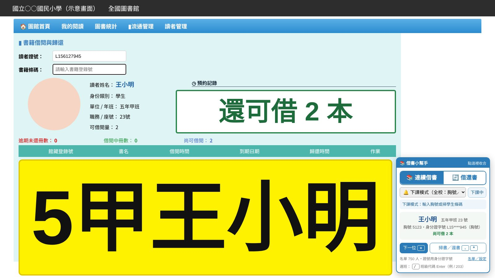
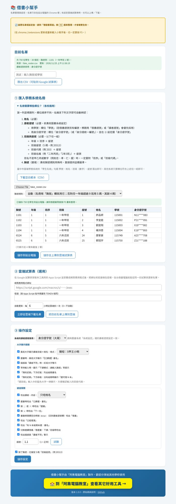
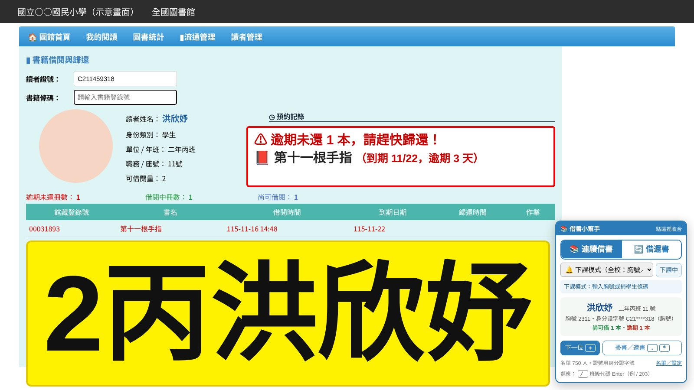
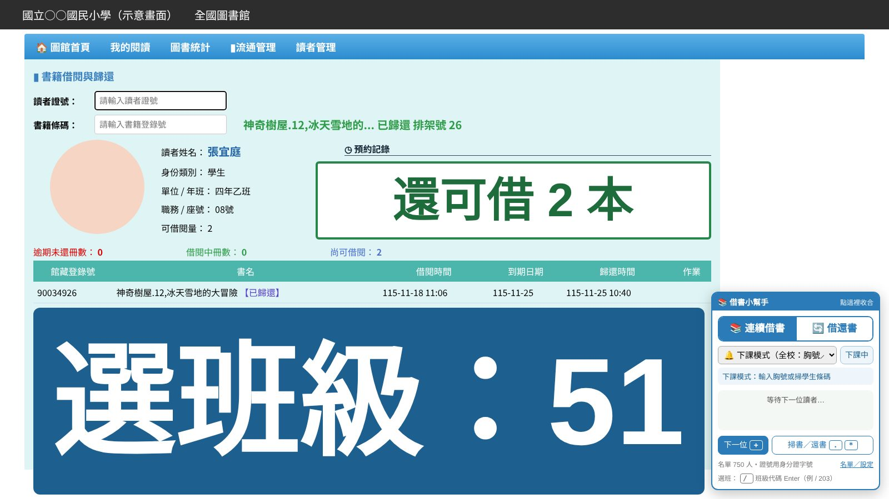
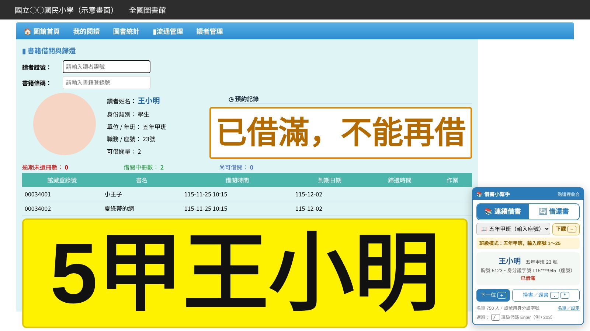
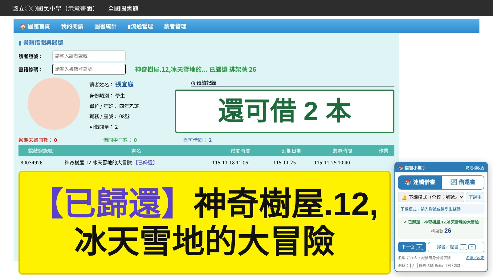
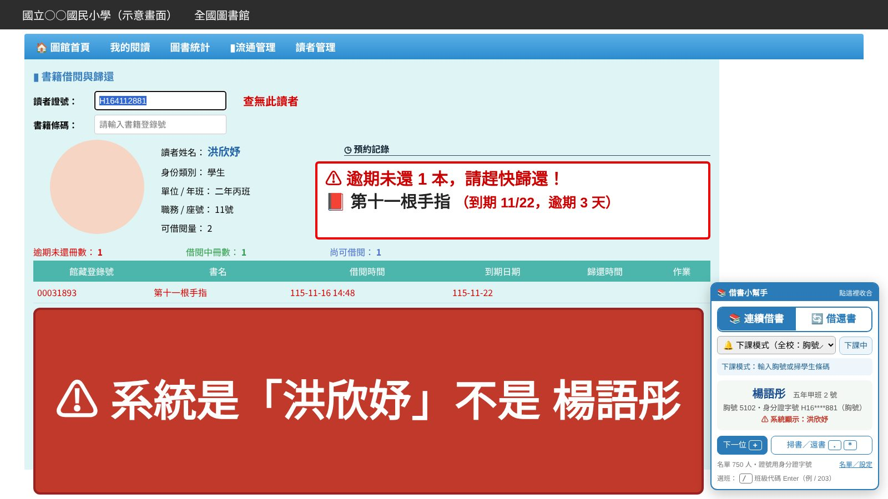
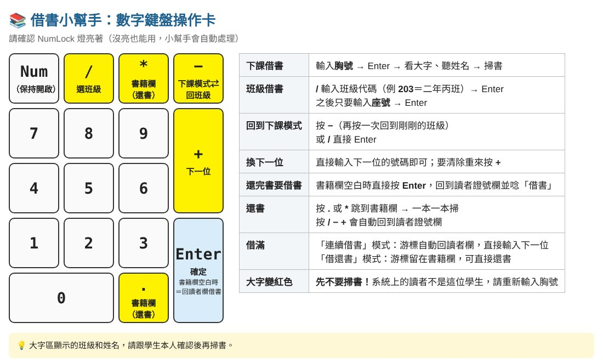

# 📚 借書小幫手

**全國閱讀推動與圖書管理系統（read.k12ea.gov.tw）借還書輔助工具**　Chrome 擴充功能

學生只要說出**胸號**（例如二年丙班 13 號 → `2313`），志工輸入後，小幫手就會：

- 🔊 **唸出學生姓名**，並在畫面上用**超大字**顯示「2丙王小明」，避免借錯人
- ⌨️ 自動填入**讀者證號**（學號或身分證字號），游標直接跳到書籍欄，馬上就能掃書
- 🚨 系統畫面上的讀者跟輸入的學生**不一樣**時，整塊變紅並**擋下掃書**
- 📕 有逾期書時，紅框列出書名、逾期天數，並唸出來提醒歸還
- 🔄 還書時唸出「已歸還，書名」，大字顯示 **【已歸還】書名**
- 🔢 **只用右側數字鍵盤**就能完成借書、還書、換班級，志工不必碰滑鼠

> 不需要伺服器、不改動圖書系統；學生名單只存在借書電腦的 Chrome 裡。
> 作者：[阿集電腦教室](https://sites.google.com/view/linyuchi/)

（以上及以下截圖皆為模擬頁面與虛構資料，實際畫面以圖書系統為準）

---

## 目錄

1. [為什麼需要它](#一為什麼需要它)
2. [功能總覽](#二功能總覽)
3. [下載與安裝](#三下載與安裝)
4. [匯入學生名冊](#四匯入學生名冊)
5. [設定](#五設定)
6. [志工操作流程](#六志工操作流程)
7. [數字鍵盤快速鍵](#七數字鍵盤快速鍵)
8. [多台電腦共用名單（Google 試算表，選用）](#八多台電腦共用名單google-試算表選用)
9. [常見問題](#九常見問題)
10. [個資與安全](#十個資與安全)
11. [授權與致謝](#十一授權與致謝)

---

## 一、為什麼需要它

下課時間來借書的學生來自不同班級，志工要在一大本條碼冊裡翻找學生的借書證條碼，一個學生常常要找很久。

借書小幫手讓志工**直接輸入學生的胸號**（或班級借書時只輸入**座號**），由程式查出學生、自動帶入讀者證號，並用語音與大字幫忙確認，省下翻條碼冊的時間，也降低借錯人的機會。

## 二、功能總覽

| 功能 | 說明 |
|---|---|
| 胸號／座號／學號都能輸入 | 下課時輸入胸號；班級借書時選好班級，只要輸入座號；也可以照常掃學生條碼 |
| 兩個欄位都能輸入學生 | 掃完書不用切欄位，直接在書籍欄輸入下一位的胸號，會自動轉到讀者證號欄 |
| 讀者證號可選學號或身分證字號 | 依貴校圖書系統的設定 |
| 超大字確認區 | 表格下方空白處用整塊大字顯示「班級＋姓名」 |
| 讀者不符防呆 | 系統畫面上的讀者姓名與輸入的學生不同時（例如證號錯誤、查無此人而畫面停在上一位），變紅色並擋下掃書 |
| 逾期提醒 | 「預約記錄」下方紅框列出逾期書名與逾期天數；沒有逾期時顯示「還可借 N 本」 |
| 連續借書／借還書兩種模式 | 連續借書：借滿自動回讀者欄；借還書：借滿後游標留在書籍欄方便還書 |
| 還書提示 | 唸出並大字顯示「【已歸還】書名」，連續快速還書會自動打斷上一句 |
| 數字鍵盤操作 | `+ − * / .` 與 Enter 就能完成所有操作 |
| 各項顯示與語音都可開關 | 設定頁每一項都能個別勾選 |
| 通用各校胸號規則 | 4 碼、5 碼、自訂格式，或直接用名冊裡的胸號欄 |

## 三、下載與安裝

> 每台借書電腦做一次。需要 **Google Chrome**（或 Microsoft Edge）。

1. **下載**：在本頁上方按綠色 **Code → Download ZIP**，解壓縮。
2. 把裡面的 **`借書小幫手`** 資料夾複製到借書電腦的固定位置，例如 `C:\借書小幫手\`。
   > ⚠️ Chrome 會直接讀這個資料夾，安裝後**不要刪除或搬移**。
3. Chrome 網址列輸入 `chrome://extensions` 並按 Enter。
4. 打開右上角的 **「開發人員模式」**。
5. 按左上角 **「載入未封裝項目」**，選擇剛剛的 `借書小幫手` 資料夾。
6. 按網址列右邊的拼圖圖示，把 **「借書小幫手」釘選**到工具列。點這個圖示就會開啟「名單與設定」頁。

**更新版本**：用新版資料夾覆蓋舊的 → 到 `chrome://extensions` 按小幫手的 🔄 重新載入 → **借還書頁面按 F5**。

## 四、匯入學生名冊

### 名冊需要的欄位（各校通用）

第一列是標題列，欄位順序不拘，標題含下列文字即可自動辨認：

| 欄位 | 必要 | 說明 |
|---|---|---|
| 姓名 | ✅ | |
| 讀者證號 | ✅ | 依圖書系統設定：用**學號** → 要有「學號」欄（若借書證號另有編號，標題用「借書證號」或「讀者證號」會優先採用）；用**身分證字號** → 要有「身分證字號」（或「身分證統一編號」）欄 |
| 班級與座號 | ✅（任一組） | ①年級＋班序＋座號　②班級座號（5 碼，例 `20313`）　③班級代碼（例 `203`）＋座號　④班級名稱（例「二年丙班」「2年3班」）＋座號 |
| 胸號 | 選填 | 貴校胸號規則特殊時直接提供，最準 |

- 班名是「忠、孝、仁、愛」這類文字時，一定要附「班序」或「班級代碼」。
- **臺中市雲端學務系統**：學生名冊匯出時勾選學號、身分證字號、姓名、班級（數字）、座號即可。
- 其他系統可參考 [`名冊範本.csv`](名冊範本.csv) 整理。

### 匯入步驟

1. 點工具列的小幫手圖示，開啟「名單與設定」頁。
2. 在 **① 匯入學務系統名冊** 選擇名冊檔（`.xlsx`、`.xls`、`.csv` 都可以）。
3. 選擇**胸號規則**（預設「自動」即可）：

   | 規則 | 二年丙班 13 號的胸號 |
   |---|---|
   | 自動（預設）：名冊有胸號欄就用；否則任一年級超過 9 班用 5 碼，其餘 4 碼 | `2313` |
   | 4 碼 `GCSS`：年級＋班序 1 碼＋座號 2 碼 | `2313` |
   | 5 碼 `GCCSS`：年級＋班序 2 碼＋座號 2 碼（＝班級座號） | `20313` |
   | 使用名冊的「胸號」欄 | 照名冊 |
   | 自訂：`G`/`GG` 年級、`C`/`CC` 班序、`S`/`SS` 座號 | 例 `GGCCSS` → `020313` |

4. 看預覽與檢查結果（缺讀者證號、胸號重複、判斷不出班級的學生都會列出），沒問題就按 **「儲存到這台電腦」**。
5. 到借還書頁面按 **F5**。

> 轉學生或名單有異動時，重新匯出、匯入一次即可；有用雲端試算表的話，也可以直接改試算表。

## 五、設定

設定頁 **③ 操作設定**（預設全部開啟，每項可個別關閉）：

- **系統的讀者證號使用**：身分證字號（預設）／學號。**必須和圖書系統的設定一致**，否則會出現「讀者不符」。
- **大字顯示開關**：讀者班級＋姓名（可選「5甲王小明」或「5年甲班王小明」）、【已歸還】書名、錯誤與讀者不符紅底警示、還書中、逾期書名紅框、還可借 N 本綠框。
- **語音開關**：唸讀者（只唸姓名或含班級座號）、已歸還書名、按 `.` `*` 唸「還書」、按 `+` 唸「下一位」、書籍欄空白 Enter 唸「借書」、已借滿、逾期書名、切換模式或班級、錯誤警示；可調語速並試聽。
- **也接受 5 碼班級座號**：使用 4 碼胸號時，`2313` 和 `20313` 都查得到同一位學生。

> 🔄 變更名單或設定後，請到借還書頁面按 **F5** 重新整理。

> 語音使用 Windows 內建的中文語音。如果沒有聲音或不是中文，請到 Windows「設定 → 時間與語言 → 語言」，在「中文（台灣）」裡安裝「語音」。

## 六、志工操作流程

打開圖書系統 **流通管理 → 書籍借閱與歸還**，右下角會出現「借書小幫手」面板。

### 1. 選工作模式（面板最上方的大按鈕）

| 模式 | 適合 | 學生借滿時 |
|---|---|---|
| 📚 **連續借書**（預設） | 下課、班級借書時間，一位接一位借 | 唸「已借滿，請換下一位」，游標回到**讀者證號欄** |
| 🔄 **借還書** | 有人來還書、借還混合 | 唸「已經借滿」，游標留在**書籍條碼欄**，方便直接還書 |

### 2. 下課借書（各班學生混在一起）

1. 問學生胸號，輸入 `2313` → Enter（讀者欄或書籍欄都可以）。
2. 聽姓名、看大字，**跟學生本人確認**。
3. 掃書。借滿時小幫手會提醒並準備好下一位。

| 黃底大字＝可以掃書 | 有逾期書時的提醒 |
|---|---|
|  |  |

### 3. 班級借書時間（同一班）

1. 按 `/`，輸入班級代碼（例 `203`＝二年丙班，也可打 `23`）→ Enter。
2. 之後只要輸入**座號**（例 `13`）→ Enter。
3. 按 `−` 回到下課模式（再按一次回到剛才的班級）。

| 選班級 | 班級模式輸入座號 |
|---|---|
|  |  |

### 4. 還書

> 游標在**書籍欄**、而且系統畫面上**沒有讀者姓名**時，大字區會顯示紫色的 **「還書中」**，提醒操作人員現在是還書；游標回到讀者欄時，大字區會先隱藏，等下一個操作。

1. 按 `.` 或 `*`（或直接用滑鼠點書籍欄）跳到書籍欄（按鍵會唸「還書」）。
2. 一本一本掃。每本都會唸出並大字顯示「【已歸還】書名」，面板顯示排架號。
3. 還完要借書：書籍欄空白時按 **Enter**，回到讀者證號欄（會唸「借書」）。

### 5. 看到紅色大字時

代表**系統畫面上的讀者不是輸入的學生**（例如讀者證號設定不對、查無此人而系統停在上一位）。這時小幫手會**擋下掃書**，請重新輸入胸號或按 `+`。

## 七、數字鍵盤快速鍵

| 按鍵 | 功能 |
|---|---|
| 數字 + Enter | 輸入胸號／座號／學號 |
| `.` 或 `*` | 跳到書籍條碼欄（還書） |
| `/` | 選班級：`/ 203 Enter`；`/` 直接 Enter＝下課模式 |
| `−` | 下課模式 ⇄ 回到剛才的班級 |
| `+` | 下一位（清除並回到讀者證號欄） |
| 書籍欄空白時 Enter | 回到讀者證號欄借書 |
| 主鍵盤 Esc／F2 | 下一位／跳到書籍欄 |

NumLock 沒開也能輸入數字。可列印 [`數字鍵盤操作卡.html`](數字鍵盤操作卡.html)（用瀏覽器開啟後列印）貼在櫃檯：

## 八、多台電腦共用名單（Google 試算表，選用）

只有一台借書電腦的話可以跳過。

1. 新建一份 Google 試算表 →「擴充功能 → Apps Script」，貼上 [`GoogleAppsScript_Code.gs`](GoogleAppsScript_Code.gs) 全部內容並儲存。
2. 「專案設定（齒輪）→ 指令碼屬性」新增屬性 `TOKEN`，值設一組 **20 字以上**的密語。
3. 「部署 → 新增部署作業 → 網頁應用程式」：執行身分「我」、存取權「任何人」→ 部署並複製網址（`…/exec`）。
4. 在一台電腦的設定頁 **②** 填入網址與密語 → 匯入名冊時按「儲存並上傳到雲端試算表」。
5. 其他電腦填同樣的網址與密語 → 「立即從雲端下載名單」。之後每 6 小時自動更新（可調整）。

> 網址必須搭配正確密語才能讀寫，試算表本身維持不公開。

## 九、常見問題

**Q：輸入胸號後大字變紅，寫「系統是○○不是△△」？**
A：系統沒有查到這位學生。最常見的原因是設定頁「讀者證號使用」和圖書系統的設定不一致（學號／身分證字號），或名冊裡這位學生的證號是空的、錯的。

**Q：怎麼確認小幫手是不是最新版？**
A：面板右下角會顯示版本號（例如 v1.1.0），可以和本頁的最新版本比對。更新後記得到 `chrome://extensions` 重新載入並按 F5。

**Q：面板沒有出現？**
A：確認在「書籍借閱與歸還」頁面，並按 F5。仍然沒有的話，到 `chrome://extensions` 確認小幫手已啟用。

**Q：改了設定沒生效？**
A：借還書頁面按 F5。更新小幫手版本後一定要按 F5。

**Q：沒有聲音？**
A：檢查電腦音量與設定頁的語音開關；按設定頁的「試聽」測試。Windows 需要安裝中文（台灣）語音。

**Q：學生名單多久要更新一次？**
A：每學期開學、或有轉入轉出時重新匯入即可。

**Q：可以給其他學校用嗎？**
A：可以，各校只要匯入自己的名冊、選好胸號規則與讀者證號類型即可。程式裡沒有任何學生資料。

## 十、個資與安全

- 學生名單只存在借書電腦 Chrome 的擴充功能資料中，不會傳到作者或任何第三方。
- 面板與設定頁上的身分證字號一律遮罩顯示（例 `A12****789`）。
- 小幫手只在 `read.k12ea.gov.tw` 上執行；只有在你自己設定了 Google 試算表網址時，才會連到你的 Apps Script。
- 使用雲端試算表且名單含身分證字號時：試算表請放在學校帳號、不要分享，密語請設長一點。
- 借書電腦若是多人共用，請注意 Windows 帳號與 Chrome 的使用權限。

## 更新紀錄

- **v1.1.2**：「還書中」改為同時符合「游標在書籍欄」與「系統畫面上沒有讀者姓名」才顯示。
- **v1.1.1**：「已借滿，不能再借」改為紅色閃爍；借滿後游標回到讀者欄時，黃底大字仍保留該生班級姓名。
- **v1.1.0**：依實際系統（AngularJS）調整：書籍欄輸入胸號改為直接呼叫系統的查讀者功能，並攔下多餘的 Enter，修正「讀者證號為空」與「無讀者」；新增「還書中」大字提示；大字區定位改良，不再出現左側直立怪框；書號長度只在系統確認借出／歸還後才記錄；支援 6 碼 AAAAAA／BBBBBB 指令。
- **v1.0.0**：第一版。

## 十一、授權與致謝

- 讀取 Excel 名冊使用 [SheetJS](https://sheetjs.com/)（Apache License 2.0，授權全文見 `借書小幫手/xlsx_LICENSE.txt`）。
- 本工具與「全國閱讀推動與圖書管理系統」無關，非官方軟體；系統改版時可能需要更新。
- 這是一位國小資訊老師的業餘作品，歡迎各校免費使用、分享。

---

🏫 更多好用工具：**[阿集電腦教室](https://sites.google.com/view/linyuchi/)**
